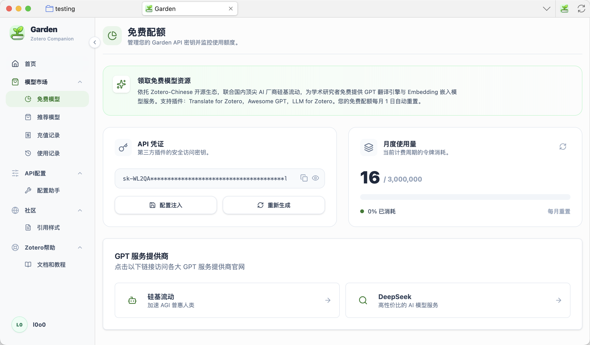
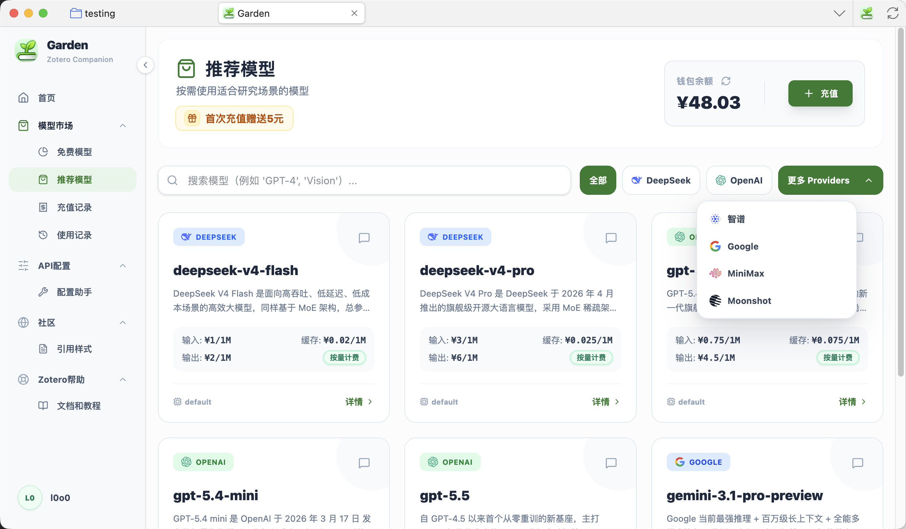
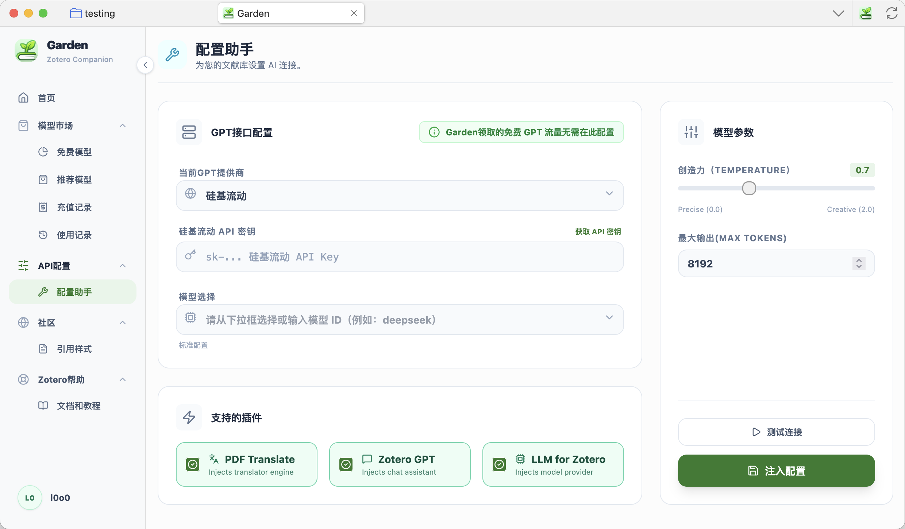
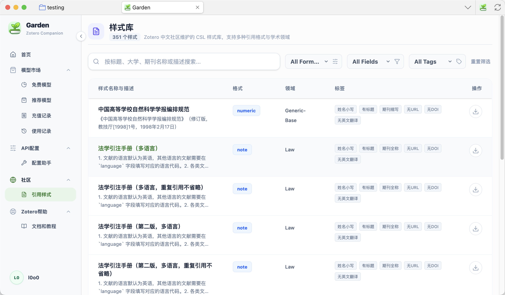
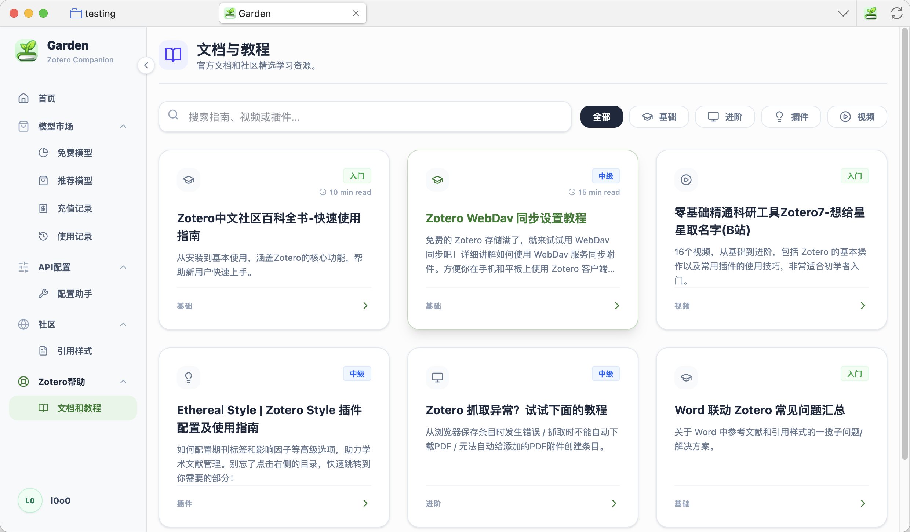

# Garden for Zotero - 发布版本

专为中国宝宝研制的 Zotero 插件发布仓库。

## 📦 安装方法

1. 下载最新的 `garden_{version}.xpi` 文件
2. 打开 Zotero，进入 Tools → Add-ons
3. 点击右上角齿轮图标，选择 "Install Add-on From File..."
4. 选择下载的 `garden_{version}.xpi` 文件安装

## ✨ 主要功能

- 🔐 用户认证系统
- 🎁 免费大模型，开箱即用，可作为免费翻译服务
- 🤖 全球顶尖大模型 API 集成，支持多个 Zotero 插件生态
- 📊 Token 使用统计
- 🛠️ 配置自动注入支持
- 🎓 Zotero 中文社区资源快速获取

**免费模型**
支持 Translate for Zotero（作为免费翻译引擎）， Awesome GPT 和 LLM for Zotero


**推荐模型，在Zotero中快速接入全球顶尖大模型**
现在你可以在 Garden 的推荐模型列表中，快速将国内外的顶尖模型一键配置到 Zotero 插件中，无效复杂手动配置。


**API配置工具**
支持国内外多家大模型接口提供商，包括 硅基流动，DeepSeek、阿里百炼、字节、小米、MiniMax、Kimi，Google，OpenAI等


**中文社区CSL资源下载**
与 https://zotero-chinese.com/styles/ 网站同步更新 CSL 样式文件，支持查询和下载，让你不必离开 Zotero 就能快速下载样式文件。


**Zotero帮助文档**
精选全网的 Zotero 教程文档和视频，让你快速入门，精通 Zotero 使用。


## 🔗 支持的插件

- [Translate for Zotero](https://github.com/windingwind/zotero-pdf-translate/) - PDF 翻译
- [Awesome GPT](https://github.com/MuiseDestiny/zotero-gpt) - GPT 助手
- [LLM for Zotero](https://github.com/yilewang/llm-for-zotero) - AI 智能研究助手

## 维护者发布流程

源代码仓库应位于同级的 `../garden`。先确认源仓库的版本标签（如 `v0.2.13`）与 `package.json` 版本一致，再构建生产包：

```bash
cd ../garden
pnpm run build:zotero:prod
cd ../garden_for_zotero
pnpm release:dry
pnpm release
```

发布脚本直接读取 `../garden/.scaffold/release/` 内的 XPI 和 `update.json`，无需复制文件或创建 `build` 软链接。脚本会校验版本和 SHA512，并沿用生产清单中的 Zotero 兼容范围。上传的安装包保持 `garden_v版本号.xpi` 命名。

`pnpm release:dry` 只读取本地信息，不需要 token、不联网，也不修改清单、提交或标签。预览中的远端分支状态来自本地缓存，正式发布时会重新检查。

正式发布需要发布仓库 `.env` 中的 `GITHUB_TOKEN`（该仓库的 Contents 写入权限），以及能够通过 `origin` 推送的 Git 身份。不要提交 `.env`。请在 `main` 分支执行，保持暂存区和 `update.json` 无未提交更改。

脚本会先获取远端 `main`：仅落后时自动快进；双方已分叉时停止，在生成发布提交和标签前提示修复。遇到分叉，请先执行 `git fetch origin`、`git merge origin/main`，解决冲突并提交，再重新预览。不要强推覆盖远端的历史版本。

脚本不会覆盖已有 Release，也不会强制移动已有标签。若先前失败的发布留下标签，必须确认远端状态和标签指向的提交；正式发布过的版本请递增版本号。分支和标签使用原子推送，防止只推送成功其中一个。

运行发布脚本的离线回归测试：

```bash
pnpm test
```
